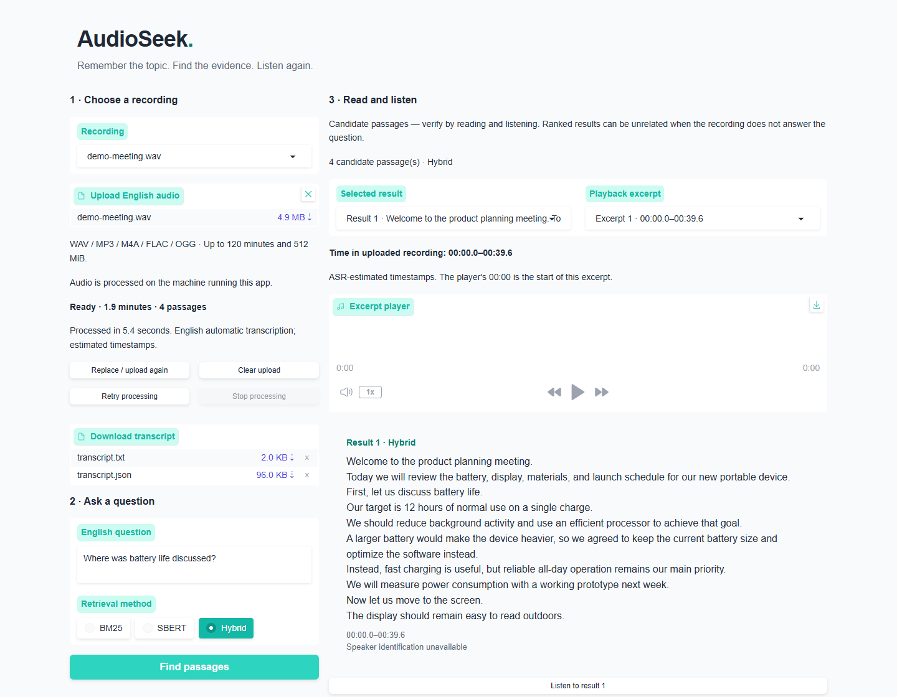
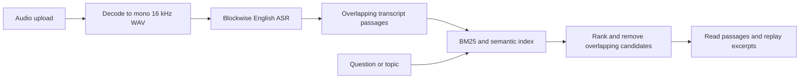

# AudioSeek

Find a topic in an English recording, read the matching passages, and replay the audio behind them.

AudioSeek runs speech recognition and retrieval on your own machine. It combines a timestamped transcript with lexical and semantic search, so you can return to a discussion without scrubbing through the entire recording.



[Watch the silent walkthrough](docs/assets/walkthrough.mp4).

<details>
<summary>Play the walkthrough inline</summary>


</details>

The capture uses synthetic English speech about a fictional product meeting. It illustrates the workflow and is not an accuracy or processing-speed benchmark.

## Features

- Upload WAV, MP3, M4A, FLAC, or OGG audio: up to **120 minutes and 512 MiB** per file. Both limits apply.
- Transcribe English speech with word timestamps and download the transcript as text or JSON.
- Search with BM25, semantic retrieval (SBERT), or a Hybrid ranking based on reciprocal rank fusion.
- Read up to five candidate passages and listen to their corresponding excerpts.
- Stop after the current transcription block, then retry the same file using completed blocks in the current session.
- Clear a session's derived audio, transcript, index, and excerpts from the application workspace.

## Quick start

Use Python **3.12 or 3.13**. A clean Windows/Python 3.12 environment has been checked with a built wheel, dependency consistency checks, regression tests, and actual browser interactions. The CI workflow defines Windows and Linux checks on both Python versions; those hosted checks run after the repository is pushed to GitHub.

Download this repository, open a terminal in its root, and create a virtual environment:

```bash
python -m venv .venv
```

Activate it in PowerShell:

```powershell
.\.venv\Scripts\Activate.ps1
```

Or activate it on Linux/macOS:

```bash
source .venv/bin/activate
```

Install the CPU build of PyTorch first, then the application:

```bash
python -m pip install --upgrade pip
python -m pip install torch==2.9.1 --index-url https://download.pytorch.org/whl/cpu
python -m pip install -e .
python -m audioseek --open-browser
```

The default address is **http://127.0.0.1:7860**. Keep the terminal running while using the app. You can also launch with `python app.py` or the installed `audioseek` command.

The first launch downloads approximately 240 MB of pinned model files from Hugging Face. Startup waits for those downloads and model loading. An internet connection is required initially; subsequent launches reuse verified local files. No inference API key is needed. PyAV handles audio decoding, so this path does not require a separate FFmpeg executable.

The terminal shows four setup stages: preparing the search model, loading its encoder, preparing the speech model, and loading speech recognition. Downloads report file sizes and percentages. Interrupted downloads retry up to three times; already verified files are kept. If setup still fails, check the message and rerun the same command.

To prepare model files separately before starting the interface:

```bash
python -m audioseek --download-models
```

Use the same `--data-dir` for preparation and launch if you customize storage. This command downloads and verifies files, then exits without starting inference or a web server.

For macOS or other architectures, availability of these exact binary dependency versions has not been verified.

### Use the app

1. Upload an English recording and wait for the ready message.
2. Ask a question or enter a topic, such as “Where was the battery life discussed?”
3. Choose a retrieval method and select **Find passages**.
4. Read the results. Select **Listen to result** to play an excerpt. A result can have multiple excerpts.
5. Download the transcript if useful. Select **Clear upload** to remove the session's application working files.

Times above the player refer to the original recording. The excerpt player's `00:00` refers to the start of the excerpt.

### Storage and ports

By default, models and session files are stored under `~/.cache/audioseek`, outside the repository. Choose a different directory or port with:

```bash
python -m audioseek --data-dir ./data --port 7861 --open-browser
```

`AUDIOSEEK_DATA_DIR` also sets the default storage directory. Command-line `--data-dir` takes precedence. The app binds to loopback and does not create a public Gradio sharing link.

## How it works



Transcription uses `Systran/faster-whisper-base.en` on CPU with int8 inference, word timestamps, voice activity detection, and 15-minute processing blocks. Completed blocks have checksummed checkpoints.

Passages target 120 words with 25% overlap and respect a 256-token limit. Semantic search uses `sentence-transformers/multi-qa-MiniLM-L6-cos-v1`, with separate query/document encoding, normalized 384-dimensional embeddings, and cosine similarity. Hybrid retrieval combines complete BM25 and semantic rankings with equal-weight reciprocal rank fusion (`K=60`), then removes substantially overlapping candidates.

Model revisions and file checksums are recorded in `audioseek/config/`. The application checks model files and embedding caches rather than silently substituting a different model.

## Limits and data handling

- This version supports English recordings and English queries. It does not identify speakers or generate answers.
- Results are candidate evidence, not verified answers. An unrelated question can still return passages. Read and listen before relying on a result.
- Speech recognition and word timestamps are estimates. Noise, overlapping speech, accents, and block boundaries can affect accuracy. No universal time-location accuracy is claimed.
- Processing time depends on hardware and recording content. A two-hour input is an accepted capacity, not a guarantee of a particular runtime.
- Retry uses the current session identity. Browser/session loss or an application restart does not provide a supported resume workflow.
- Recordings and derived files are written to local disk on the machine running the app. The app performs inference there; model downloads contact Hugging Face. Gradio analytics are disabled.
- **Clear upload** deletes application working files for that session. It does not delete the original recording or exported downloads. Gradio also manages its own temporary upload/download copies; these are not immediately erased by that button. Do not treat it as a secure-erasure feature.
- This is a single-machine application. Authentication, a durable multi-user job queue, and a production deployment configuration are outside its current scope.

## Development

After installation, run:

```bash
python -m unittest discover -s tests -v
```

Tests cover decoding boundaries, timestamp offsets, playback ranges, block recovery, cooperative stopping, ranking fusion, and cache integrity. They use generated fixtures and do not download model weights. To check real inference, start the app and upload a recording you can use.

The GitHub Actions workflow builds an sdist and wheel, installs the wheel, checks dependencies, and runs tests and launcher checks in Python's isolated mode. This checks installed package resources instead of relying on imports from the source checkout. See [validation notes](docs/VALIDATION.md) for the completed local checks and remaining platform coverage.

```text
audioseek/
  audio.py                 Audio decoding and clip extraction
  base.py                  Models, session storage and search
  service.py               Blockwise transcription and indexing
  controls.py              Stop/retry coordination
  retrieval.py             Chunking and BM25
  semantic.py              Embeddings and ranking fusion
  ui.py                    Gradio interface and launcher
  config/                  Model references and runtime defaults
tests/                     Model-independent regression tests
docs/                      Setup and troubleshooting
```

## Credits and licensing

AudioSeek uses [Gradio](https://github.com/gradio-app/gradio), [faster-whisper](https://github.com/SYSTRAN/faster-whisper), [Sentence Transformers](https://github.com/UKPLab/sentence-transformers), [rank-bm25](https://github.com/dorianbrown/rank_bm25), and [PyAV](https://github.com/PyAV-Org/PyAV).

See [THIRD_PARTY.md](THIRD_PARTY.md) for model sources and upstream references. Model weights, third-party recordings, and datasets are not included in this repository. No license has been selected for AudioSeek's own source code; upstream components retain their own terms.
